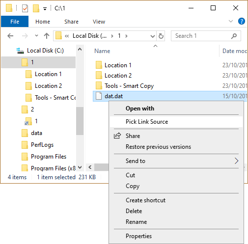
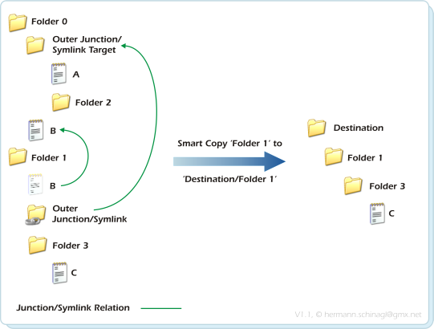
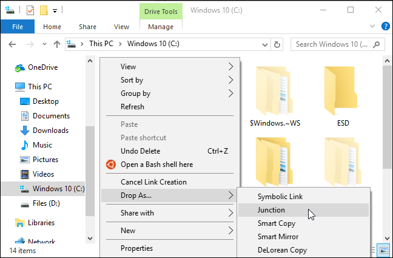

# Link Shell Extension

Link Shell Extension is HardLinkShell for Windows Explorer. Pick a source, Drop As a hard link, a junction, or a symbolic link. You do not type mklink.

link shell extension hardlinks keep one file body under many names on NTFS. link shell extension junctions point a folder at another folder. Symbolic links do both files and folders when the policy allows it.

link shell extension windows 11 still uses Pick Link Source and Drop As. The first right-click can be the short modern list. Open Show more options if the LSE rows sit on the classic menu.

Use the GET badge for this pack. Vendor setup is on the Schinagl Link Shell Extension page. Install the x64 package on a 64-bit PC. Restart Explorer if the menu is missing.

## Features

- Pick Link Source and Drop As
- HardLinkShell overlay icons on linked items
- link shell extension hardlinks on files
- link shell extension junctions on folders
- Symbolic links when Windows allows them
- Smart Copy and Smart Mirror
- Volume mount points
- Works on link shell extension windows 11 and Windows 10

| Type | Target | Notes |
| --- | --- | --- |
| Hard link | File | Same data, many names |
| Junction | Folder | Folder pointer, no extra copy |
| Symbolic link | File or folder | Policy and rights apply |
| Smart Copy | Tree | Keeps existing links |

| Piece | What it is |
| --- | --- |
| HardlinkShellExt.dll | Explorer menu |
| LSEConfig.exe | Options |
| ln.exe | Command line twin |

Menu host is [LinkShellExtension.cpp](LinkShellExtension.cpp). Menu verbs are [LinkShellMenu.cpp](menu/LinkShellMenu.cpp). Overlay icons are [IconOverlay.cpp](overlay/IconOverlay.cpp).

A FAT or exFAT volume cannot hold these links. Use NTFS. A USB stick that is FAT will fail Drop As.

Do not run two link shells on the same Explorer. They fight for Pick Source.

## Demo

Pick a file. Right-click Pick Link Source. Open the destination folder. Right-click Drop As. Choose Hardlink, Junction, or Symbolic Link.

The overlay on the new name is HardLinkShell telling you it is a link, not a second copy.

Copy hook is [CopyHook.cpp](overlay/CopyHook.cpp). Link create sample is [links.rs](links/links.rs). Hardlink engine is [hardlinks.cpp](links/hardlinks.cpp).

A junction to a dead path still shows until you delete it. Explorer then says the target is missing. Fix the target. Do not add a second junction with the same name.

## v0.2.3 Scope

Stock Link Shell Extension already covers pick, drop, overlays, and Smart Copy. This pack describes that product, not a second installer.

Config UI is [LSEConfig.cpp](config/LSEConfig.cpp). Settings store is [LSESettings.cpp](config/LSESettings.cpp). General page is PropPageGeneral.cpp under config/.

Picked state lives with the user until you Drop As or clear it. A new Explorer window still sees the pick.

x64 is the usual setup. An old 32-bit Explorer on a 64-bit PC will miss the dll. Use the matching bitness.

## Usage

Right-click a file or folder. Pick Link Source. Go to the destination. Drop As. Choose the type.

On link shell extension windows 11 use Show more options if you do not see Pick Link Source on the first menu.

Hard link is for a file. Junction is for a folder. Symbolic link is for either when Developer Mode or elevation allows it.

Hardlink icon page is [PropPageIconHardlink.cpp](hardlink/PropPageIconHardlink.cpp). Junction icon page is [PropPageIconJunction.cpp](junction/PropPageIconJunction.cpp). Symlink icon page is [PropPageIconSymlink.cpp](symlink/PropPageIconSymlink.cpp).

Create Here drops in the current folder. Link Here points at the current folder. Same idea as Drop As with a type.

Do not paste a machine-local loop address as a target. Store a drive path.

A custom name is fine. The link still points at the source you picked.

## Build

You do not build Link Shell Extension to use it. The GET badge or the vendor setup does.

Pack samples show the dll, the config exe, and the ln twin. link.sln and Cargo.toml are manifests. They do not install HardLinkShell.

CLI twin is [ln.cpp](ln.cpp). Shell crate sample is [shell/lib.rs](shell/lib.rs). Helper start is helper/main.rs.

### Executable File

HardlinkShellExt.dll is the Explorer piece. LSEConfig.exe is the options window. ln.exe is the console twin for scripts.

GUI sample is [winlinker.py](winlinker.py). Dialog sample is [main_windows_ui.py](ui/main_windows_ui.py).

### Installer

Vendor msi or exe registers the dll. After setup, restart Explorer. Then Pick Link Source on a test file.

Install script sample is [install.ps1](install/install.ps1). Uninstall sample is uninstall.ps1 under install/. Appx sample is AppxManifest.xml at pack root.

A domain PC can block unsigned shell extensions. Use the signed vendor build.

## General

Link Shell Extension started as HardLinkShell. The dll name still says that. The menu names say Link Shell Extension.

Smart Copy copies a tree and keeps hard links inside it. Smart Mirror updates a copy without breaking those links. That is backup without a second full tree.

Utils are HardlinkUtils.cpp under links/. Reparse bits are Reparse.h in the same folder.

Column provider is ColumnProvider.cpp under column/. It can show a link column in details view if you turn it on.

## Infrastructure

NTFS is required. ReFS may accept some links. FAT does not. Network shares depend on the server.

UAC helper is part of the vendor zip. Elevation is needed under Program Files.

Solution file is link.sln. World build is BuildWorld.bat. Those files are pack samples.

State sample is state.rs under config/. Core lib is core/lib.rs.

## Compiling

Skip compile if you only want the menu. Developers open link.sln. Users click GET.

Def file is LinkShellExtension.def. Resource script is HardLink.rc. Header is LinkShellExtension.h under menu/.

A self-signed test dll is not the vendor build. Prefer the GET badge.

## Testing

Pick a file on NTFS. Drop a hard link next to it. Both names should open the same bytes. Delete one name. The other stays.

Pick a folder. Drop a junction. Open it. You see the source tree. Delete the junction. The source stays.

On link shell extension windows 11 repeat under Show more options if the first menu is short.

Property sheet is PropertySheetPage.cpp under config/. English strings are en-US.json under i18n/.

## Install Media

Vendor media is the Schinagl zip or setup. This pack is a handbook.

WiX samples sit under install/. Spec file is winlinker.spec. Requirements file is requirements.txt. They do not replace the LSE setup.

## Documentation

Vendor html lives on the official page. F1 is not inside Explorer. Open LSEConfig for options.

Package script is package.ps1 under scripts/. Release workflow is release.yml in the same folder.

Do not store a work token in a screenshot of Drop As.

## Distribution

x64 is the usual far-side download name people want. ARM64 exists on some pages. Match the PC.

ci.yml is pack CI. Cargo.lock is a lockfile. resource.qrc is a UI resource sample.

One copy of the dll. Two installs fight.

## Status

If Pick Link Source is missing, the dll did not load. Check bitness, then restart Explorer.

If Drop As says incorrect function, the volume is not NTFS or the type does not match (hard link on a folder).

If overlays vanish after a Windows feature update, repair the vendor setup.

## License Notice

Schinagl Link Shell Extension uses the vendor license. One LICENSE file covers pack samples. Do not add a second LICENSE beside README.

Cargo.toml and requirements.txt are pack manifests.

A hard link on a second volume fails. Hard links stay on one NTFS volume. Use a junction or a symbolic link to cross volumes when the OS allows it.

A symbolic link to a file needs a policy that allows it. Developer Mode on link shell extension windows 11 is the usual fix. Elevation is the other.

Smart Mirror is not robocopy by another name. It tries to keep link structure. Test on a small tree first.

Clone of a folder with hard links is a tree of names, not a second copy of bytes. Tools that count size by name will lie. Check size on disk.

Delete of one hard link name is not delete of the file until the last name goes. That is NTFS, not a bug in HardLinkShell.

Recycle Bin and a junction can surprise you. Delete the junction, not the target, if you only wanted the pointer gone.

Explorer search can list both names of a hard link. That is expected.

link shell extension symbolic links follow the target when you open them. A dangling symlink is a red overlay or an error. Recreate it.

link shell extension explorer context menu is Pick and Drop. There is no extra tray icon.

link shell extension smart copy is the tree copy that keeps links. link shell extension smart mirror updates that copy.

link shell extension official website is the Schinagl page. Prefer that or the GET badge over random portals.

link shell extension safe: the vendor build is a shell dll. Submit that hash if a scanner flags a mirror.

link shell extension incorrect function is usually FAT or a hard link on a folder. Switch type or volume.

A second monitor does not change Drop As. The destination is the folder you right-clicked.

Sleep keeps the pick if Explorer stays. A restart of Explorer clears some picks. Pick again.

Fast user switch is a second profile. Install or enable the dll there too if that user needs the menu.

A VM with a virtual FAT disk will fail. Attach NTFS.

Safe mode may skip the extension. Test in a normal session.

High contrast does not restyle overlays. The overlay is an icon, not a theme color.

Closing LSEConfig does not unregister the dll. Uninstall does.

Backup the list of junctions you care about. A reimage wipes them.

Do not put a junction on a system folder you do not own. Updates can break.

Take a file that already has many hard links. Drop As another. The count goes up. That is HardLinkShell doing its job.

Mount points are a volume in a folder. Use them when a drive letter is not enough. They are not a junction to a random share.

UNC junctions can fail in Explorer even when the reparse is valid. That is a Windows limit. Use a drive letter path when you can.

German and other UI strings follow the vendor language pack if present. English is the default in this pack sample (en-US.json).

zh-CN.json is a pack language sample. It does not replace LSEConfig.

machine-wide vs per-user installers in the pack are samples. The vendor setup is the one you run.

If overlays stack with another overlay dll, turn one off in LSEConfig or the other tool.

Repair after a Windows feature update: vendor setup, then Explorer restart, then one Pick and Drop test.

A custom overlay icon in LSEConfig is optional. The default HardLinkShell mark is enough to see a link in a busy folder.

Sort Explorer by name. The hard link name sorts like any file. The overlay is how you tell it apart.

If Drop As is grey, you did not Pick, or the destination volume cannot take that type. Pick again on NTFS.

Clear the pick from the menu if the vendor build offers that, then start over with one file.

## Related Search Terms

Link Shell Extension, HardLinkShell, link shell extension windows 11, link shell extension hardlinks, link shell extension junctions, context-menu, hardlink, junction, symlink, windows-11, explorer, ntfs, shell-extension, windows, filesystem, overlay, portable
